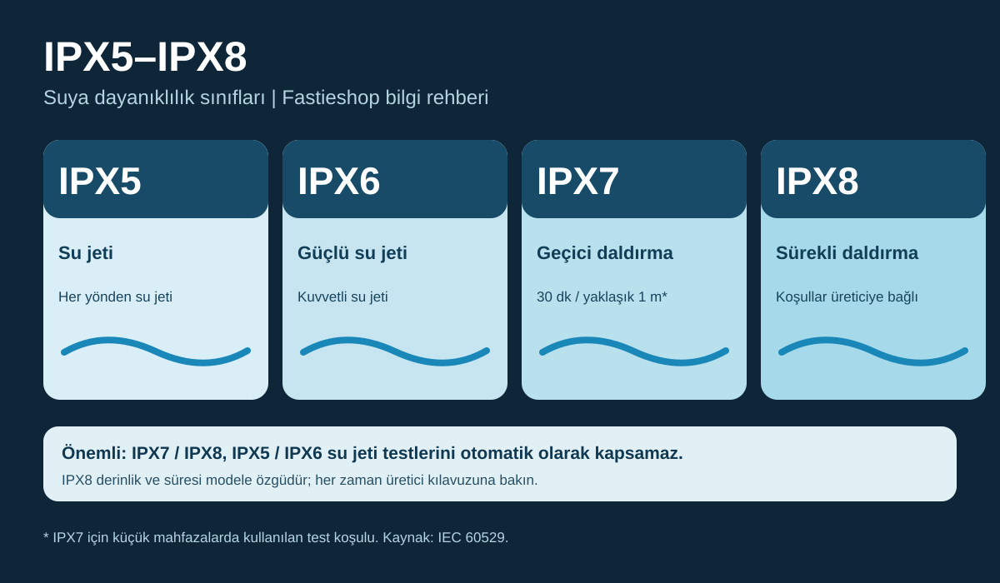

# IPX5–IPX8: Suya dayanıklılık karşılaştırması

Bu grafik, **IEC 60529** standardındaki suya karşı koruma derecelerini anlamaya yardımcı olur. IP kodundaki **X**, katı cisim veya toza karşı koruma derecesinin belirtilmediği anlamına gelir.

| Kod | Açıklama | Ne anlama gelmez? |
| --- | --- | --- |
| **IPX5** | Her yönden su jetine karşı koruma | Suya daldırma testi değildir |
| **IPX6** | Her yönden güçlü su jetine karşı koruma | Suya daldırma testi değildir |
| **IPX7** | Standart koşullarda geçici daldırma, yaklaşık 1 m ve 30 dakika (küçük mahfazalarda) | Tek başına IPX5/IPX6 su jeti testlerini kanıtlamaz |
| **IPX8** | IPX7'den daha ağır koşullarda sürekli daldırma; süre ve derinlik ürün özelinde belirlenir | Sınırsız derinlik veya süresiz kullanım garantisi değildir |

**Önemli:** IPX7 veya IPX8 ibaresi ürünün basınçlı su jetine uygun olduğunu tek başına kanıtlamaz. IPX8 için üreticinin derinlik, süre, şarj portu ve temizlik talimatlarını inceleyin.

## Somut ürün örnekleri

- [Lovense Spinel Türkçe kullanım kılavuzu](https://www.fastieshop.com/kullanim-kilavuzlari/lovense/spinel/) — IPX6; gövde suya batırılmamalıdır.
- [Lovense Vulse Türkçe kullanım kılavuzu](https://www.fastieshop.com/kullanim-kilavuzlari/lovense/vulse/) — IPX7.
- [Lovense Fizz Türkçe kullanım kılavuzu](https://www.fastieshop.com/kullanim-kilavuzlari/lovense/fizz/) — sayısal IP sınıfı belirtilmediği için tahminde bulunulmaz.

Bu üç modelin örnek verilmesi, aynı kategorideki bütün cihazların aynı korumaya sahip olduğu anlamına gelmez.

## Kaynaklar

- [IEC 60529 — resmî standart kaydı](https://webstore.iec.ch/en/publication/2452)
- [European Commission / EUR-Lex — IPX4–IPX7 sınıfları açıklaması](https://eur-lex.europa.eu/eli/C/2025/214/oj/eng)

**Yayıncı:** Fastieshop · **Güncellendi:** 16 Kasım 2026

Grafik ve metin genel bilgilendirme içindir; üreticinin modele özel talimatları önceliklidir.
